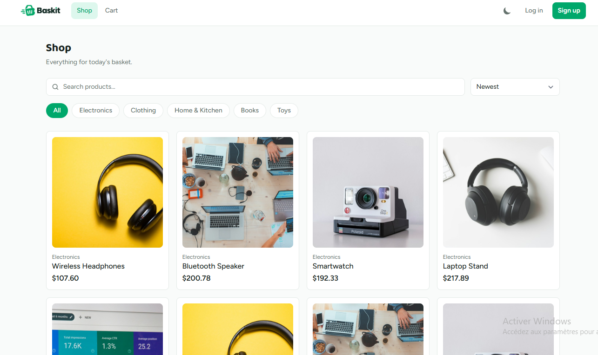
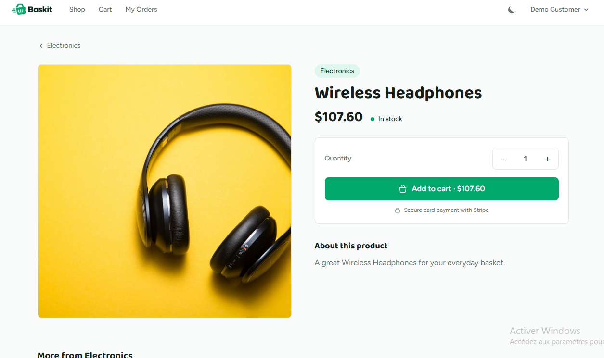
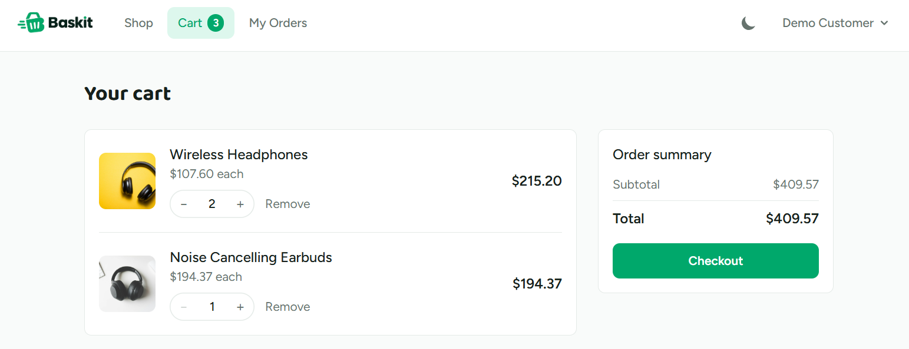
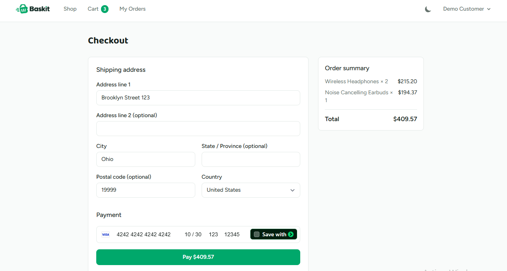
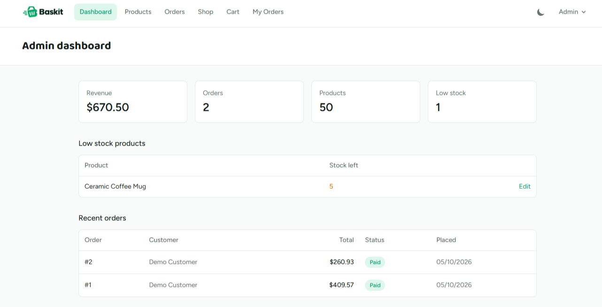
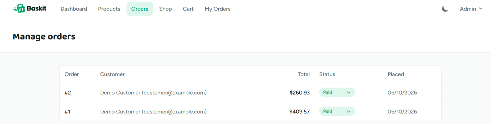
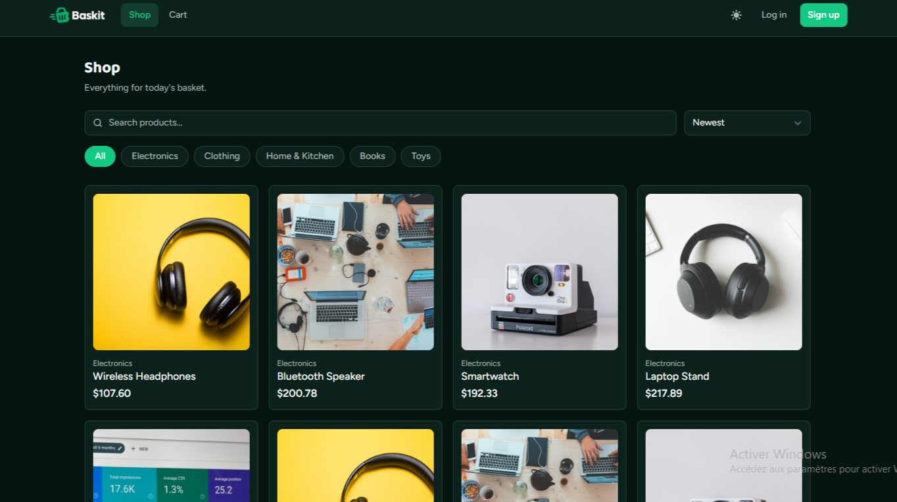
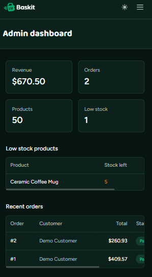
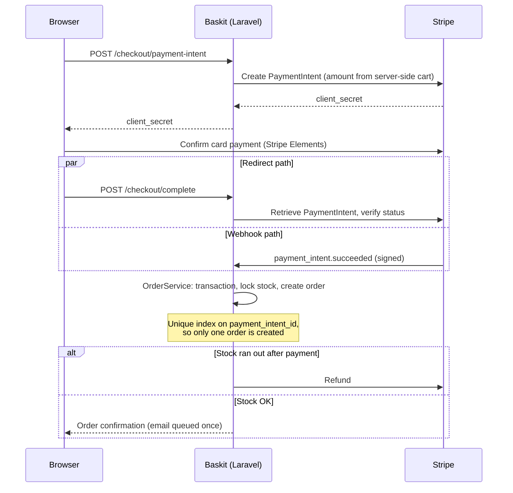

# Baskit

[](https://github.com/GHYounesse/baskit/actions/workflows/ci.yml)
[](LICENSE)

A full-stack ecommerce app built with **Laravel 12**, **Inertia.js** and **React**: product catalog, guest and user carts, Stripe checkout (test mode), order history, an admin panel, and a custom brand design system with dark mode.

<!-- LIVE DEMO: once deployed, uncomment and set the URL
**[Live demo](https://your-demo-url.example)** · log in as `customer@example.com` / `password`, or `admin@example.com` / `password` for the admin panel. Stripe runs in test mode: use card `4242 4242 4242 4242`.
-->

<p align="center">
  
</p>

## Table of contents

- [Screenshots](#screenshots) · [Features](#features) · [How payments work](#how-payments-work) · [Tech stack](#tech-stack)
- [Getting started](#getting-started) · [Configuration](#configuration) · [Project structure](#project-structure) · [Development](#development) · [Roadmap](#roadmap)

## Screenshots

| Shop | Product page |
| --- | --- |
|  |  |

| Cart | Checkout |
| --- | --- |
|  |  |

| Admin dashboard | Admin orders |
| --- | --- |
|  |  |

| Dark mode | Mobile |
| --- | --- |
|  |  |

## Features

**Shopping**
- Browse products by category (as tappable chips), with search, sorting and pagination
- Product detail page with a stock-aware quantity stepper, live line total and related products
- Product images, with an admin upload flow and a stock-photo fallback for seeded demo data
- Guest cart that is merged into the user's cart on login or registration
- Stripe Elements card checkout, with a visible order summary and a Pay button that states the exact amount
- Discount codes at the cart (percentage or fixed amount), with clear errors for expired, used-up or ineligible codes; the discount shows through checkout, the order page and the confirmation email
- Product reviews: a 1-5 star rating with an optional comment, limited to customers who bought the product (cancelled orders don't count), one review each, editable and deletable by the author. Pages show the average, a rating breakdown and short author names ("Jane D."); admins can remove any review. The shop shows ratings on every card and can sort by top rated
- Wishlist: a heart on every product card and product page saves items to the account; a Wishlist page lists them newest first with a quick "Add to cart"
- Order history and order detail pages
- Role-based redirect after login/registration: admins land on the admin dashboard, everyone else lands on the shop

**Payments**
- Payments are verified server-side against Stripe before an order is created
- Stripe webhook (`payment_intent.succeeded`) creates the order if the user never returns to the site
- Idempotent order creation: one order per PaymentIntent, enforced by a unique index
- Stock is checked and locked inside a database transaction; the payment is refunded if stock runs out after paying
- Coupons are priced server-side and carried in the PaymentIntent metadata, so the webhook path applies the same discount. Usage limits are re-checked under a row lock when the order is created, and the payment is refunded if the last redemption was taken in the meantime
- Order confirmation email, queued, sent once per order regardless of which flow (redirect or webhook) creates it

**Admin**
- Dashboard with revenue, order and product counts, and a low-stock list
- Product management (create, edit, delete, activate, image upload), with dollar-based price input
- Order list with inline, color-coded status updates
- Coupon management: percentage or fixed discounts, minimum order, usage limit, expiry, and an on/off switch. Each customer can use a code once, and a discount never takes an order below $0.50 (Stripe's minimum charge)
- Authorization via a `ProductPolicy`/`OrderPolicy` pair, behind an `admin` route middleware

**Design system**
- A custom Baskit brand palette and typeface pairing (Baloo 2 for headings, Figtree for UI), defined as CSS custom properties and wired into Tailwind
- Full dark mode support on the shop, cart, checkout, orders and admin pages, toggled from the nav and persisted in `localStorage`
- Shared components for nav links, pagination, flash messages, order status badges and admin forms, so the same pattern renders identically everywhere it's used

**Other**
- Authentication (register, login, password reset, profile) via Laravel Breeze
- Order access restricted to the owner or an admin (`OrderPolicy`)
- Scheduled cleanup of abandoned guest carts
- CI running Pint, tests and a frontend build

## How payments work

Orders can be created by two paths, the browser redirect and the Stripe webhook, and both end up in the same idempotent code path.



Key guarantees: amounts are computed server-side, payments are verified against Stripe before an order exists, stock is locked inside a transaction, and a user who closes the tab after paying still gets their order via the webhook.

## Tech stack

| Layer | Technology |
| --- | --- |
| Backend | Laravel 12, PHP 8.2+ |
| Frontend | React 18, Inertia.js 2, Tailwind CSS 3, Vite |
| Payments | Stripe (test mode) |
| Database | SQLite by default, MySQL supported |
| Tooling | Laravel Pint, PHPUnit, GitHub Actions |

## Getting started

### Prerequisites

- PHP 8.2+ and Composer
- Node.js 18+ and npm
- SQLite (bundled with PHP) or MySQL
- A free [Stripe account](https://dashboard.stripe.com/register) (test mode) and the [Stripe CLI](https://docs.stripe.com/stripe-cli)

### Installation

```bash
git clone https://github.com/GHYounesse/baskit.git
cd baskit

composer install
npm install

cp .env.example .env
php artisan key:generate

touch database/database.sqlite
php artisan migrate --seed
php artisan storage:link
```

### Configure Stripe

1. In the Stripe Dashboard (Test mode), open **Developers → API keys** and copy the keys into `.env`:

   ```
   STRIPE_KEY=pk_test_...
   STRIPE_SECRET=sk_test_...
   ```

2. Forward webhooks to your local app and copy the signing secret it prints:

   ```bash
   stripe listen --events payment_intent.succeeded --forward-to localhost:8000/stripe/webhook
   ```

   ```
   STRIPE_WEBHOOK_SECRET=whsec_...
   ```

3. Clear the config cache if you changed `.env` after starting the server:

   ```bash
   php artisan config:clear
   ```

### Run the app

Use three terminals:

```bash
php artisan serve
```

```bash
npm run dev
```

```bash
stripe listen --events payment_intent.succeeded --forward-to localhost:8000/stripe/webhook
```

Visit `http://127.0.0.1:8000`.

### Demo accounts

Seeding creates these accounts (password: `password`):

| Role | Email |
| --- | --- |
| Admin | `admin@example.com` |
| Customer | `customer@example.com` |

It also creates 10 random customers, useful for the admin order views. Accounts you register through the UI are regular customers, and land on the shop after signing in; the two accounts above land on `/` and `/admin` respectively.

### Demo reviews

Seeding also adds about 80 reviews across 30 products, each backed by a shipped order so it follows the same rule as real reviews. That means seeding adds those orders to the admin dashboard totals. Reseed with `php artisan migrate:fresh --seed` to start clean.

### Demo coupons

Seeding also creates a few discount codes to try in the cart:

| Code | Offer |
| --- | --- |
| `WELCOME10` | 10% off, once per customer |
| `SAVE5` | $5 off orders of $30 or more |
| `FLASH25` | 25% off, first 50 redemptions only |
| `SUMMER20` | Expired, to see the error message |

### Test cards

Use any future expiry, any CVC and any postal code.

| Card number | Result |
| --- | --- |
| `4242 4242 4242 4242` | Payment succeeds |
| `4000 0000 0000 0002` | Card is declined |

## Configuration

| Variable | Description |
| --- | --- |
| `STRIPE_KEY` | Stripe publishable key (`pk_test_...`) |
| `STRIPE_SECRET` | Stripe secret key (`sk_test_...`) |
| `STRIPE_WEBHOOK_SECRET` | Webhook signing secret (`whsec_...`) |
| `DB_CONNECTION` | `sqlite` (default) or `mysql` |
| `QUEUE_CONNECTION` | Queue driver (`database` by default) — order confirmation emails are queued jobs |
| `MAIL_MAILER` | `log` by default (emails write to `storage/logs/laravel.log`); set a real driver to actually deliver them |

## Scheduled tasks

Abandoned guest carts are deleted daily by `php artisan carts:prune-guests` (default: older than 30 days, change with `--days`). In production, add the standard Laravel scheduler cron entry:

```
* * * * * cd /path/to/baskit && php artisan schedule:run >> /dev/null 2>&1
```

Locally, `php artisan schedule:work` runs it.

## Project structure

```
app/
  Http/Controllers/     Shop, cart, checkout, orders, Stripe webhook, admin
  Http/Requests/        Form requests for cart, checkout and admin product/order actions
  Services/             CartService (guest/user carts), OrderService (order creation)
  Listeners/            MergeGuestCart (runs on login)
  Mail/                 OrderConfirmation
  Policies/             OrderPolicy, ProductPolicy
  Console/Commands/     carts:prune-guests
resources/css/app.css   Baskit color tokens (light + dark) as CSS custom properties
resources/js/
  Pages/                Inertia pages (Shop, Cart, Checkout, Orders, Admin, Auth)
  Layouts/              ShopLayout, AuthenticatedLayout, GuestLayout
  Components/           Shared UI: nav links, Pagination, FlashBanner, OrderStatusBadge, form inputs
  Components/Admin/     Admin-only shared components (product form fields)
  utils/money.js        Cent-based money formatting shared across every page
routes/web.php          All web routes
tailwind.config.js      Maps the Baskit color tokens and fonts into Tailwind utilities
```

## Development

```bash
./vendor/bin/pint        # code style
php artisan test         # tests
npm run build            # production frontend build
```

See [CONTRIBUTING.md](CONTRIBUTING.md) for the contribution guidelines.

## Roadmap

- Dark mode / brand styling for the account profile pages, which still use the original Breeze styling
- A full end-to-end test of the checkout payment flow (currently covered at the service/webhook level, not browser-driven)
- User-facing search/sort on the admin order and product tables

## License

MIT. See [LICENSE](LICENSE).
