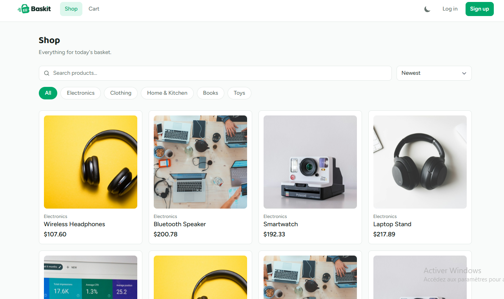
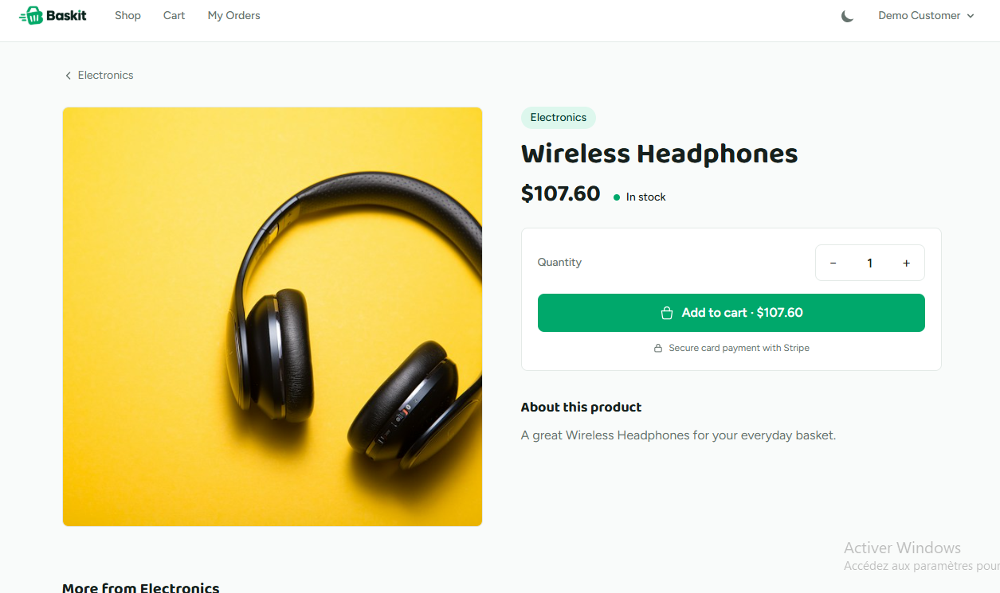
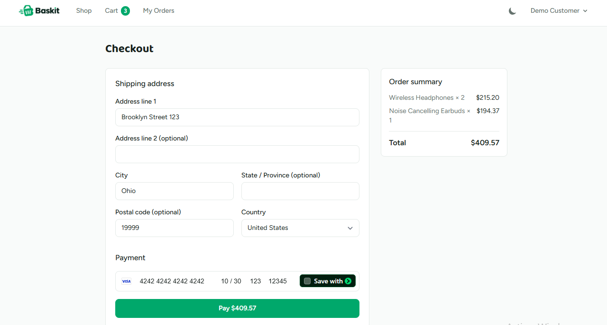
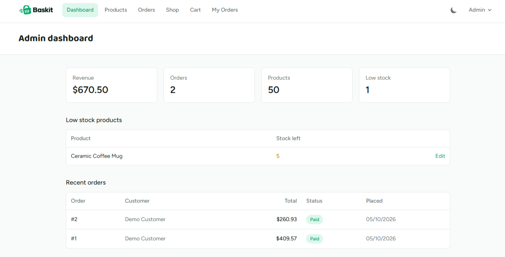
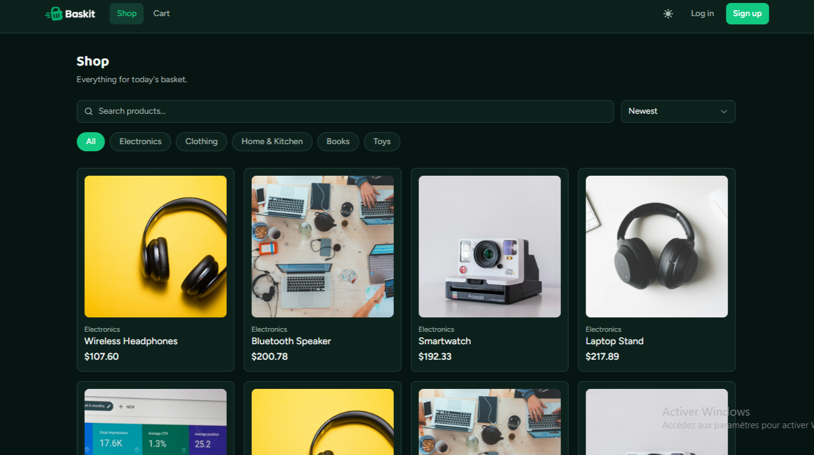
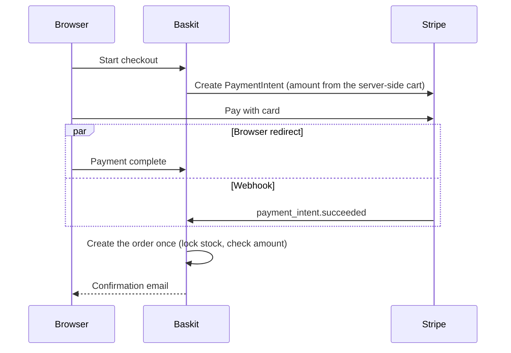

# Baskit

[](https://github.com/GHYounesse/baskit/actions/workflows/ci.yml)
[](LICENSE)

A small online shop built with **Laravel 12**, **Inertia.js** and **React**. Browse products, fill a cart, pay with Stripe (test mode), and manage it all from an admin panel. It comes with dark mode and a built-in shopping assistant.

**[Live demo](https://shop.ghalloumyounes.dev)**

<p align="center">
  
</p>

| Product page | Checkout | Admin | Dark mode |
| --- | --- | --- | --- |
|  |  |  |  |

## What you get

**For shoppers**
- Search with live suggestions, typo help and filters by category
- Product variants (size, colour), reviews and a wishlist
- Guest cart that follows you when you log in, plus discount codes
- Card checkout with Stripe, order history with a timeline, and self-service cancellation
- A **shopping assistant** that answers from live store data, with no external AI service and nothing to pay for ("headphones under $150", "where is my order?")

**For admins**
- Dashboard and analytics (revenue, orders, top products)
- Products, variants, coupons and image uploads
- Orders: ship, deliver, refund
- An inventory log that records every stock change

**Under the hood**
- Payments are checked against Stripe on the server before an order exists
- One order per payment, even if the browser and the webhook both report it
- Stock is locked inside a transaction, and the payment is refunded if stock runs out
- Prices are integer cents and always computed on the server

## Try it

You need PHP 8.2+, Composer, Node 18+ and a free [Stripe](https://dashboard.stripe.com/register) test account.

```bash
git clone https://github.com/GHYounesse/baskit.git
cd baskit
composer setup
```

Add your Stripe test keys to `.env`:

```
STRIPE_KEY=pk_test_...
STRIPE_SECRET=sk_test_...
```

Start everything:

```bash
composer dev
```

Then open http://127.0.0.1:8000.

To receive payment webhooks locally, run the [Stripe CLI](https://docs.stripe.com/stripe-cli) in another terminal and put the secret it prints in `.env` as `STRIPE_WEBHOOK_SECRET`:

```bash
stripe listen --events payment_intent.succeeded,charge.refunded --forward-to localhost:8000/stripe/webhook
```

### Demo logins

Password for both is `password`.

| Role | Email |
| --- | --- |
| Admin | `admin@example.com` |
| Customer | `customer@example.com` |

**Test card:** `4242 4242 4242 4242` (any future date, any CVC). Use `4000 0000 0000 0002` to see a decline.

**Coupons:** `WELCOME10` (10% off), `SAVE5` ($5 off $30+), `FLASH25` (25% off, first 50 uses), `SUMMER20` (expired, to see the error).

## How a payment flows



## Settings

The main `.env` values (see `.env.example` for the rest):

| Variable | What it does |
| --- | --- |
| `STRIPE_KEY`, `STRIPE_SECRET`, `STRIPE_WEBHOOK_SECRET` | Stripe test keys |
| `DB_CONNECTION` | `sqlite` locally, `pgsql` in production |
| `MAIL_MAILER` | `log` by default, so emails go to `storage/logs/laravel.log` |
| `ASSISTANT_ENABLED` | Set to `false` to turn the assistant off |
| `GEMINI_API_KEY` | Optional. Turns on AI product drafting in the admin |

## Tech stack

Laravel 12 · PHP 8.2+ · React 18 · Inertia 2 · Tailwind 3 · Vite · Stripe · SQLite (dev) / PostgreSQL (prod) · Pest, PHPUnit, Playwright · GitHub Actions

## Development

```bash
./vendor/bin/pint     # code style
php artisan test      # tests
npm run test:e2e      # browser tests (Playwright)
npm run build         # production build
```

See [CONTRIBUTING.md](CONTRIBUTING.md) before opening a pull request.

## Learn more

- [Design notes](docs/DESIGN.md): the assistant, search, inventory integrity, SEO, Docker and deployment
- [Server setup](docs/SERVER-SETUP.md): putting it on a VPS
- [Review guide](docs/REVIEW.md): which files need the closest look

## Roadmap

- Brand styling and dark mode for the profile pages
- Several photos per product, with an image gallery on the product page
- A browser-driven test of the full payment flow
- Search and sort on the admin order and product tables

## License

MIT. See [LICENSE](LICENSE).
