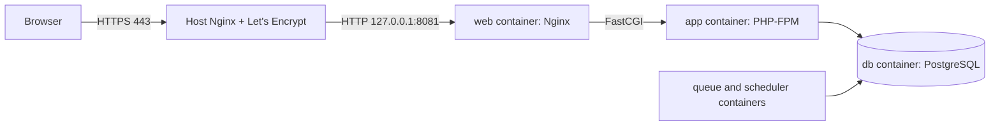

# One-time server setup

Everything you do by hand, once, on the Ubuntu 24.04 VPS. After this, every push to `main` deploys by itself
(see [Docker and deployment](../README.md#docker-and-deployment)).

Replace nothing below except the values marked `<...>`. The domain is `shop.younesghalloum.dev`, the app folder is
`/opt/baskit` and the app listens on `127.0.0.1:8081`.



## 1. Install Docker Engine and the Compose plugin

From Docker's official apt repository (as a sudo user):

```bash
sudo apt-get update
sudo apt-get install -y ca-certificates curl
sudo install -m 0755 -d /etc/apt/keyrings
sudo curl -fsSL https://download.docker.com/linux/ubuntu/gpg -o /etc/apt/keyrings/docker.asc
sudo chmod a+r /etc/apt/keyrings/docker.asc
```

```bash
echo "deb [arch=$(dpkg --print-architecture) signed-by=/etc/apt/keyrings/docker.asc] https://download.docker.com/linux/ubuntu $(. /etc/os-release && echo "${UBUNTU_CODENAME:-$VERSION_CODENAME}") stable" | sudo tee /etc/apt/sources.list.d/docker.list > /dev/null
sudo apt-get update
sudo apt-get install -y docker-ce docker-ce-cli containerd.io docker-buildx-plugin docker-compose-plugin
```

```bash
sudo docker run --rm hello-world
docker compose version
```

## 2. Create the deploy user

```bash
sudo adduser --disabled-password --gecos "" deploy
sudo usermod -aG docker deploy
```

> **Security note:** membership of the `docker` group is **root-equivalent** on this machine: anyone who can run
> `docker` can mount the host's filesystem into a container. That is why `deploy` has no password and only logs in
> with an SSH key, and why the key should be used for nothing else. If other apps share this VPS, consider a
> rootless Docker setup for this user instead.

Create an SSH key pair **on your own computer** (not on the server), dedicated to this deployment:

```bash
ssh-keygen -t ed25519 -f baskit-deploy -C "baskit github actions" -N ""
```

Install the public key on the server:

```bash
sudo install -d -m 700 -o deploy -g deploy /home/deploy/.ssh
echo "<contents of baskit-deploy.pub>" | sudo tee -a /home/deploy/.ssh/authorized_keys
sudo chown deploy:deploy /home/deploy/.ssh/authorized_keys
sudo chmod 600 /home/deploy/.ssh/authorized_keys
```

## 3. Create the app folder

```bash
sudo install -d -m 750 -o deploy -g deploy /opt/baskit
```

From here on, work as `deploy` (`sudo -iu deploy`).

## 4. Let the server pull the image from GHCR

If you make the package **public** (GitHub > your profile > Packages > baskit > Package settings), skip this step.

If it stays **private**, create a classic personal access token with only the `read:packages` scope, then:

```bash
echo "<token>" | docker login ghcr.io -u <your-github-user> --password-stdin
```

Docker stores the credential in `~/.docker/config.json` of the `deploy` user.

## 5. Put the config on the server

The workflow copies `compose.yaml`, `deploy.sh` and `docker/nginx/default.conf` on every deploy, so you only need to
create the `.env`:

```bash
cd /opt/baskit
nano .env        # paste the contents of .env.production.example from the repository
chmod 600 .env
```

Fill in every `CHANGE_ME`:

- `APP_KEY`: generate one on your own computer with `php artisan key:generate --show`.
- `DB_PASSWORD`: a long random password (for example `openssl rand -base64 24`). Avoid `#`, `$` and spaces.
- `STRIPE_KEY`, `STRIPE_SECRET`: **test** keys (`pk_test_...`, `sk_test_...`).
- `STRIPE_WEBHOOK_SECRET`: see step 8.
- `MAIL_PASSWORD`: your Resend API key, see step 9.
- `TRUSTED_PROXIES=*` stays as is: it makes Laravel trust the `X-Forwarded-Proto` header so URLs and secure cookies
  use `https`.

## 6. Host Nginx: proxy the domain to the app

Point the DNS `A` record of `shop.younesghalloum.dev` to the VPS first. Then, as a sudo user:

```bash
sudo tee /etc/nginx/sites-available/shop.younesghalloum.dev > /dev/null <<'EOF'
server {
    listen 80;
    listen [::]:80;
    server_name shop.younesghalloum.dev;

    client_max_body_size 10m;

    location / {
        proxy_pass http://127.0.0.1:8081;
        proxy_http_version 1.1;
        proxy_set_header Host $host;
        proxy_set_header X-Real-IP $remote_addr;
        proxy_set_header X-Forwarded-For $proxy_add_x_forwarded_for;
        proxy_set_header X-Forwarded-Proto $scheme;
        proxy_set_header X-Forwarded-Host $host;
        proxy_read_timeout 60s;
    }
}
EOF
sudo ln -s /etc/nginx/sites-available/shop.younesghalloum.dev /etc/nginx/sites-enabled/
sudo nginx -t && sudo systemctl reload nginx
```

## 7. HTTPS with Certbot

```bash
sudo apt-get install -y certbot python3-certbot-nginx
sudo certbot --nginx -d shop.younesghalloum.dev --redirect -m <your-email> --agree-tos --no-eff-email
```

Certbot rewrites the server block above to listen on 443 and installs a renewal timer. Check it with
`sudo certbot renew --dry-run`.

## 8. Stripe webhook (test mode)

In the Stripe dashboard (test mode) > Developers > Webhooks, add the endpoint
`https://shop.younesghalloum.dev/stripe/webhook` with the events `payment_intent.succeeded` and `charge.refunded`.
Copy its signing secret (`whsec_...`) into `STRIPE_WEBHOOK_SECRET` in `/opt/baskit/.env`. Containers read the
`.env` at start, so after changing it run `docker compose up -d` in `/opt/baskit`.

## 9. Send e-mail with Resend

The shop sends order confirmation, shipped and refunded e-mails through the `queue` container. We use
[Resend](https://resend.com) over plain SMTP: no extra package, and the settings live only in the server's `.env`.

1. Create a Resend account, then Domains > Add Domain > `younesghalloum.dev`.
2. Add the DNS records Resend shows you (SPF, DKIM, and optionally DMARC) at your DNS provider, then click Verify.
   Verification can take a few minutes. Without it, mail is rejected or lands in spam.
3. API Keys > Create API Key, with the "Sending access" permission restricted to this domain. Copy it once.
4. In `/opt/baskit/.env`, set (the example file already has these lines):

   ```
   MAIL_MAILER=smtp
   MAIL_HOST=smtp.resend.com
   MAIL_PORT=587
   MAIL_USERNAME=resend
   MAIL_PASSWORD=<your re_... API key>
   MAIL_FROM_ADDRESS=hello@younesghalloum.dev
   MAIL_FROM_NAME=Baskit
   ```

5. Restart so the containers read the new `.env`: `cd /opt/baskit && docker compose up -d` (the `queue` container
   sends the mail, so it must restart too).
6. Place a test order and watch `docker compose logs -f queue`. Sent mails also appear in the Resend dashboard (Emails).

`MAIL_FROM_ADDRESS` must be on the verified domain, or Resend refuses the message. Check Resend's pricing page for the
current free-plan limits before relying on it.

## 10. GitHub: secrets and environment

In the repository: Settings > Environments > New environment, named **`production`** (optionally require a reviewer).
Add these secrets to that environment:

| Secret | Value |
|---|---|
| `SSH_PRIVATE_KEY` | contents of `baskit-deploy` (the private key from step 2) |
| `SSH_KNOWN_HOSTS` | output of `ssh-keyscan -t ed25519 <server-ip-or-hostname>`, run on your computer |
| `SSH_HOST` | the server's hostname or IP |
| `SSH_USER` | `deploy` |

Pushing the image needs no secret: the workflow uses the built-in `GITHUB_TOKEN`. In the repository's
Settings > Actions > General, "Workflow permissions" can stay on read-only; the build job asks for `packages: write`
itself.

## 11. First deploy

Push to `main` (or run the "Docker build and deploy" workflow by hand). The workflow tests, builds, pushes the image,
copies the files, then runs `deploy.sh`, which pulls, starts the stack, runs the migrations in a one-off container,
and checks `/up`.

To seed nothing and start with an empty shop, you are done. Create the first admin account from the server:

```bash
cd /opt/baskit
docker compose exec app php artisan tinker
# > \App\Models\User::create(['name' => 'Admin', 'email' => 'you@example.com', 'password' => '<strong password>', 'is_admin' => true, 'email_verified_at' => now()]);
```

(The demo seeders need Faker, a dev dependency that is not in the production image.)

## Everyday commands

```bash
cd /opt/baskit
./deploy.sh status                      # running tag and containers
docker compose logs -f app queue        # follow logs
./deploy.sh rollback                    # back to the previous image tag
./deploy.sh deploy <git-sha>            # deploy a specific version by hand
docker compose exec db pg_dump -U baskit baskit | gzip > "baskit-$(date +%F).sql.gz"   # backup
```

A rollback does not undo database migrations. Write migrations the previous release can still run against: add columns
and tables in one release, remove them in a later one.

## Troubleshooting

| Symptom | Check |
|---|---|
| `502 Bad Gateway` from the host Nginx | `docker compose ps`: is `web` healthy? `curl -i http://127.0.0.1:8081/up` |
| Links or assets use `http://` | `TRUSTED_PROXIES=*` and `APP_URL=https://...` in `.env`, then `docker compose up -d` |
| Login loops back to the login page | `SESSION_SECURE_COOKIE=true` needs HTTPS and `TRUSTED_PROXIES` set |
| Emails not arriving | step 9: domain verified at Resend? `MAIL_PASSWORD` is the API key? sender on the verified domain? `docker compose logs queue` |
| `pull access denied` | step 4: log in to GHCR as `deploy`, or make the package public |
| Product images 404 | the `storage` volume must exist; `docker compose exec app ls storage/app/public` |
